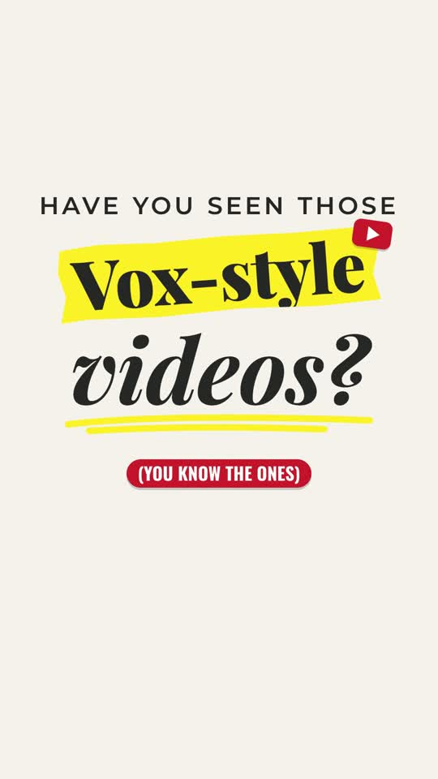

# Vox-Style Reels: a Claude skill

Make **Vox-style vertical reels** just by asking Claude: off-white paper and graph-paper backgrounds, yellow sticker tags, headlines that build word by word, red pill captions, felt-marker underlines, page-peel transitions and halftone serif type. Claude writes the scenes and renders a 1080×1920 MP4 with [HyperFrames](https://hyperframes.heygen.com).



Examples made with this skill: [explainer reel](docs/vox-style-explainer-sound-preview.mp4) · [pencil reel](docs/why-are-pencils-yellow-preview.mp4)

---

## Install

You need **[Claude Code](https://claude.com/claude-code)** (terminal, desktop app "Code" tab, or VS Code / JetBrains) and **[Node.js 18+](https://nodejs.org)**.

### Option 1: let Claude install it (easiest)

Open Claude Code and paste:

```
Install the vox-reel skill from https://github.com/chelseapersonalbrandcreativeph/vox-style-skills into ~/.claude/skills
```

### Option 2: one command in Terminal

```bash
rm -rf /tmp/vox-style-skills && git clone https://github.com/chelseapersonalbrandcreativeph/vox-style-skills.git /tmp/vox-style-skills && mkdir -p ~/.claude/skills && cp -R /tmp/vox-style-skills/vox-reel ~/.claude/skills/
```

### Option 3: download and drag

1. Click the green **Code** button above → **Download ZIP**, then unzip it.
2. Open your skills folder:
   - **Mac:** in Finder press **⇧⌘G** and go to `~/.claude/skills` (create the `skills` folder if it's missing)
   - **Windows:** `%USERPROFILE%\.claude\skills`
3. Drag the **`vox-reel`** folder into it.

Restart Claude Code. The skill shows up as `vox-reel`.

### Recommended: HyperFrames plugin

The skill renders with `npx hyperframes`, which works on its own. For the best results, also add the HyperFrames plugin in Claude Code:

```
/plugin marketplace add heygen-com/hyperframes
/plugin install hyperframes@hyperframes
```

---

## Use

Just ask:

> Make a 25-second Vox-style reel explaining why airplane windows are round.

> Turn this script into a Vox-style reel, words only, no voiceover: "..."

> Make a Vox-style reel about [topic] with background music and sound effects.

Or type `/vox-reel`.

Claude researches the topic, finds free-to-use images and sound effects, builds the scenes, checks every frame, and renders the MP4.

## What's inside

```
vox-reel/
├── SKILL.md   the style: why it works, colors, type, frame types, motion timings, pacing, rules
└── kit/       design-system templates, page-peel helper, 14 example scenes, fonts, grain, example images
```

## Credits

"Vox" names a well-known editorial video style. This project isn't affiliated with or endorsed by Vox Media. Third-party fonts, images and sounds are credited in [`vox-reel/kit/CREDITS.md`](vox-reel/kit/CREDITS.md).

MIT licensed.
